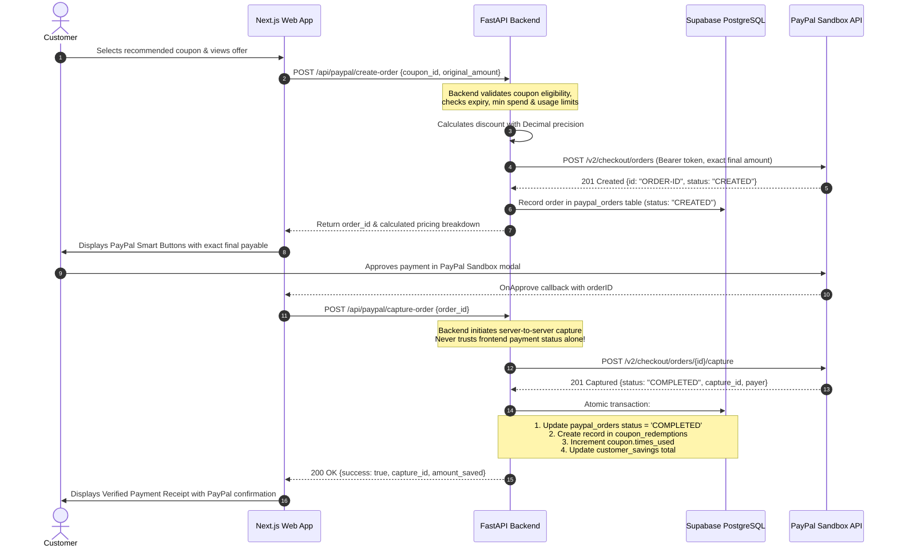

# System Architecture — PayPal SmartRewards AI

**Platform**: PayPal SmartRewards AI  
**Event**: PayPal AI Hackathon 2026  
**Architecture Version**: 2.0 (Production-Grade Monorepo)  

---

## 1. High-Level System Overview

PayPal SmartRewards AI bridges customer transaction intelligence with personalized merchant rewards to drive checkout conversion on the PayPal Developer Platform.

```
+--------------------------------------------------------------------------------------------------+
|                                    NEXT.JS FRONTEND (React 18 / TS / Tailwind)                   |
|                                                                                                  |
|  [Customer Dashboard]   [Coupon Marketplace]   [Merchant Portal]   [Admin Operations]  [AG Grid] |
|            |                      |                    |                  |                 |    |
|            +----------------------+--------------------+------------------+-----------------+    |
|                                           |                                                      |
|                             [PayPal Smart Payment Buttons]                                       |
+-------------------------------------------|------------------------------------------------------+
                                            | REST API Calls (JSON)
                                            v
+--------------------------------------------------------------------------------------------------+
|                                  FASTAPI PYTHON BACKEND (Python 3.12)                            |
|                                                                                                  |
|   /api/auth       /api/customer     /api/coupons     /api/recommendations     /api/paypal        |
|       |                 |               |                     |                    |             |
|   [Auth & Role]   [Insights API]  [Eligibility]     [AI Engine & Ranking]  [Orders v2 Client]   |
|                                                               |                    |             |
|                                                    [Scikit-learn / RFM]     OAuth2 Token Cache   |
|                                                    [LLM Explainer API]      Backend Order Create |
|                                                    [Attraction Intel]       Payment Capture Verif|
+---------------------------------------------------------------|--------------------+-------------+
                                                                |                    |
                                 +------------------------------+                    |
                                 |                                                   |
                                 v                                                   v
+---------------------------------------------------+    +-----------------------------------------+
|        DATABASE LAYER (PostgreSQL / Supabase)      |    |      PAYPAL DEVELOPER PLATFORM          |
|                                                   |    |           (Sandbox v2 API)              |
|  users               merchants      coupons       |    |                                         |
|  customer_profiles   transactions   redemptions   |    |  POST /v1/oauth2/token                  |
|  recommendations     paypal_orders  savings       |    |  POST /v2/checkout/orders               |
|                                                   |    |  POST /v2/checkout/orders/{id}/capture  |
+---------------------------------------------------+    +-----------------------------------------+
```

---

## 2. Recommendation Engine Mathematical Formulation

The AI recommendation engine derives recommendations from the customer's previous 30 days of transactions.

### A. Customer Feature Vector $\vec{C}$
For each category $k \in \{\text{food}, \text{taxi}, \text{shopping}, \text{entertainment}, \text{travel}, \text{groceries}\}$:
$$\text{SpendShare}_k = \frac{\sum \text{Amount}_{k}}{\sum \text{Amount}_{\text{total}}}$$
$$\text{RecencyDecay}_k = e^{-\lambda \cdot t_k}$$
where $t_k$ is days since last purchase in category $k$, and $\lambda = 0.05$.
$$\text{FrequencyFactor}_k = \frac{\ln(1 + \text{Count}_k)}{\ln(1 + \text{Count}_{\text{total}})}$$

The combined category affinity score is:
$$C_k = w_{\text{spend}} \cdot \text{SpendShare}_k + w_{\text{recency}} \cdot \text{RecencyDecay}_k + w_{\text{freq}} \cdot \text{FrequencyFactor}_k$$
with weights:
- $w_{\text{spend}} = 0.60$
- $w_{\text{recency}} = 0.25$
- $w_{\text{freq}} = 0.15$

Normalized customer vector:
$$\vec{C} = \frac{(C_1, \dots, C_6)}{\|\vec{C}\|}$$

### B. Coupon Affinity Vector $\vec{Q}$
The coupon category is one-hot mapped in 6-dimensional category space and normalized:
$$\vec{Q} = \text{OneHot}(\text{Category})$$

### C. Learning-to-Rank Composite Score
The final recommendation score for coupon $i$ (scaled $0$ to $100$) is computed as:
$$\text{Score}_i = \left( 0.40 \cdot \cos(\vec{C}, \vec{Q}_i) + 0.25 \cdot \text{SpendShare}_k + 0.15 \cdot \text{Affordability}_i + 0.10 \cdot \text{DiscountAppeal}_i + 0.10 \cdot \text{FreqBonus}_k \right) \times 100$$

Where:
- $\text{Affordability}_i = \min\left(1.0, \frac{\text{CustomerAvgTicket}}{\text{CouponMinOrder}}\right)$
- $\text{DiscountAppeal}_i = \min\left(1.0, \frac{\text{DiscountPct}}{50\%}\right)$

---

## 3. End-to-End Payment & Redemption Lifecycle



---

## 4. Security & Engineering Standards
1. **Zero Secret Leakage**: `PAYPAL_CLIENT_SECRET` and database service credentials are strictly consumed within backend environment variables.
2. **Server-Side Authorization & Decimal Math**: Coupon discount calculations and order totals are computed entirely server-side.
3. **Double Redemption Prevention**: Unique constraints and database transaction locks prevent concurrent over-redemption.
4. **Idempotent Capture**: Calling capture on an already completed order returns the existing verified record without double billing or redundant redemptions.
