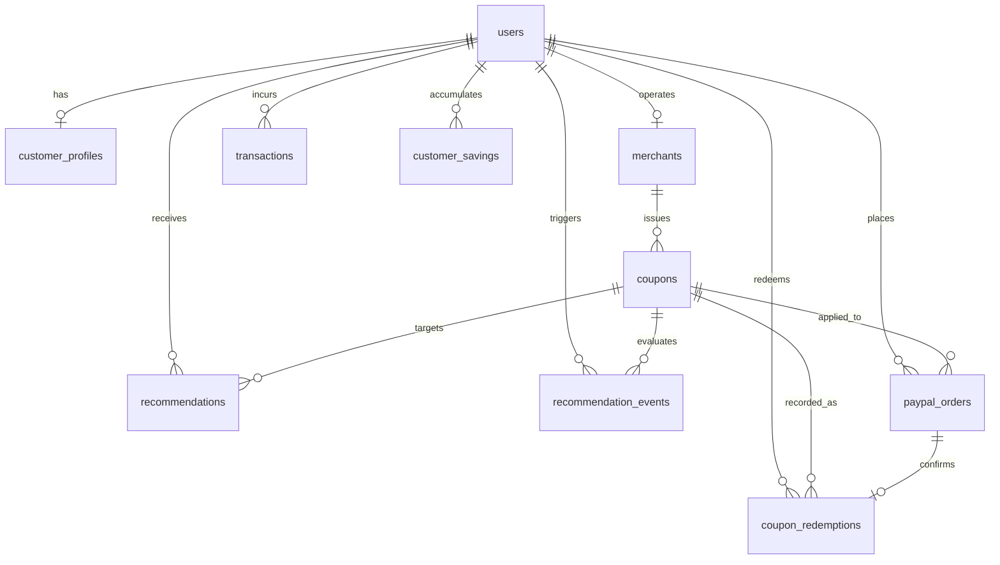

# Database Schema Documentation — PayPal SmartRewards AI

**Database Engine**: PostgreSQL 15+ / Supabase  
**Local Development**: SQLite / PostgreSQL Hybrid Layer (via SQLAlchemy 2.0 ORM)  
**Schema Date**: November 2026  

---

## 1. Entity-Relationship Overview

---

## 2. Table Specifications

### 1. `users`
Core user identity and authentication entity.
- `id` (VARCHAR(36), PK): UUID identifier.
- `email` (VARCHAR(255), UNIQUE, NOT NULL): User email.
- `full_name` (VARCHAR(255), NOT NULL): Customer or merchant legal name.
- `role` (VARCHAR(50), NOT NULL): Enum (`customer`, `merchant`, `admin`).
- `password_hash` (VARCHAR(255)): Securely hashed authentication string.
- `created_at` (TIMESTAMP): Account registration timestamp.

### 2. `customer_profiles`
Persona metadata and budgeting preferences.
- `id` (VARCHAR(36), PK): UUID identifier.
- `user_id` (VARCHAR(36), FK -> users.id, UNIQUE): 1-to-1 link to user.
- `persona_name` (VARCHAR(100), NOT NULL): Synthetic persona label (e.g., "Food Delivery Enthusiast").
- `persona_description` (TEXT): Behavioral profile notes for demo evaluation.
- `monthly_budget` (NUMERIC(12, 2)): Stated monthly consumer spending target.
- `preferred_payment_method` (VARCHAR(50)): Default wallet (`paypal`).
- `created_at` (TIMESTAMP): Timestamp.

### 3. `merchants`
Registered merchant partners issuing offers.
- `id` (VARCHAR(36), PK): UUID identifier.
- `user_id` (VARCHAR(36), FK -> users.id, NULLABLE): Linked user account.
- `business_name` (VARCHAR(255), NOT NULL): Brand name (e.g. "Swiggy Gourmet", "Uber Premier").
- `category` (VARCHAR(100), NOT NULL): Primary commercial vertical.
- `description` (TEXT): Brand description.
- `logo_url` (VARCHAR(500)): Hosted brand asset URL.
- `commission_rate` (NUMERIC(5, 2)): Contractual commission percentage (default 5.00%).
- `created_at` (TIMESTAMP): Onboarding date.

### 4. `transactions`
30-day historical customer transaction records used as AI training inputs.
- `id` (VARCHAR(36), PK): UUID identifier.
- `customer_id` (VARCHAR(36), FK -> users.id, NOT NULL): Transaction owner.
- `merchant_name` (VARCHAR(255), NOT NULL): Merchant where purchase occurred.
- `category` (VARCHAR(100), NOT NULL): Spending category (`food`, `taxi`, `shopping`, `entertainment`, `travel`, `groceries`).
- `amount` (NUMERIC(12, 2), NOT NULL): Purchase ticket size.
- `currency` (VARCHAR(10), DEFAULT 'INR'): Transaction currency.
- `payment_channel` (VARCHAR(50)): Channel used (`paypal`, `card`, `upi`).
- `timestamp` (TIMESTAMP): Exact transaction date and time.
- `is_synthetic` (BOOLEAN, DEFAULT true): Explicit flag declaring synthetic demonstration data.

### 5. `coupons`
Merchant reward configurations and redemption constraints.
- `id` (VARCHAR(36), PK): UUID identifier.
- `merchant_id` (VARCHAR(36), FK -> merchants.id, NOT NULL): Issuing merchant.
- `code` (VARCHAR(50), UNIQUE, NOT NULL): Promo code string (e.g. `SWIGGYFEAST25`).
- `title` (VARCHAR(255), NOT NULL): Marketing display title.
- `description` (TEXT): Terms and conditions summary.
- `category` (VARCHAR(100), NOT NULL): Target category.
- `discount_type` (VARCHAR(20), NOT NULL): `percentage` or `fixed`.
- `discount_value` (NUMERIC(10, 2), NOT NULL): Rate or currency deduction.
- `min_order_amount` (NUMERIC(10, 2), DEFAULT 0.00): Minimum cart spend.
- `max_discount` (NUMERIC(10, 2)): Cap for percentage coupons.
- `start_date` (TIMESTAMP): Campaign start date.
- `expiry_date` (TIMESTAMP, NOT NULL): Expiration boundary.
- `usage_limit` (INT, DEFAULT 500): Global redemption cap.
- `times_used` (INT, DEFAULT 0): Current redemptions counter.
- `is_active` (BOOLEAN, DEFAULT true): Admin/merchant kill switch.
- `created_at` (TIMESTAMP): Creation timestamp.

### 6. `recommendations`
AI model outputs generated for individual customers.
- `id` (VARCHAR(36), PK): UUID identifier.
- `customer_id` (VARCHAR(36), FK -> users.id, NOT NULL): Recipient customer.
- `coupon_id` (VARCHAR(36), FK -> coupons.id, NOT NULL): Recommended coupon.
- `match_score` (NUMERIC(5, 2), NOT NULL): Normalized confidence score (15.0 to 99.0%).
- `rationale` (TEXT, NOT NULL): Natural language and statistical explanation.
- `rank` (INT, DEFAULT 1): Ordered position in feed.
- `is_active` (BOOLEAN, DEFAULT true): Active recommendation flag.
- `created_at` (TIMESTAMP): Scoring timestamp.

### 7. `recommendation_events`
Customer Attraction Intelligence event stream.
- `id` (VARCHAR(36), PK): UUID identifier.
- `customer_id` (VARCHAR(36), FK -> users.id, NOT NULL): Consumer.
- `coupon_id` (VARCHAR(36), FK -> coupons.id, NOT NULL): Subject offer.
- `event_type` (VARCHAR(50), NOT NULL): `impression`, `click`, `apply`, `checkout_init`, `checkout_success`.
- `metadata_json` (TEXT): Optional analytics attributes.
- `timestamp` (TIMESTAMP): Event trigger time.

### 8. `paypal_orders`
Official PayPal Sandbox checkout order lifecycle tracking.
- `id` (VARCHAR(36), PK): Internal database UUID.
- `paypal_order_id` (VARCHAR(255), UNIQUE, NOT NULL): PayPal Orders API identifier.
- `customer_id` (VARCHAR(36), FK -> users.id, NOT NULL): Buyer.
- `coupon_id` (VARCHAR(36), FK -> coupons.id, NULLABLE): Applied discount coupon.
- `original_amount` (NUMERIC(12, 2), NOT NULL): Pre-discount total.
- `discount_amount` (NUMERIC(12, 2), DEFAULT 0.00): Deducted savings.
- `final_amount` (NUMERIC(12, 2), NOT NULL): Exact amount billed through PayPal.
- `currency` (VARCHAR(10), DEFAULT 'USD'): Payment currency.
- `status` (VARCHAR(50), DEFAULT 'CREATED'): `CREATED`, `APPROVED`, `COMPLETED`, `CANCELLED`, `FAILED`.
- `capture_id` (VARCHAR(255)): PayPal capture ID returned after payment execution.
- `payer_email` (VARCHAR(255)): Sandbox buyer email.
- `created_at` (TIMESTAMP): Creation timestamp.
- `updated_at` (TIMESTAMP): State modification timestamp.

### 9. `coupon_redemptions`
Verified financial ledger linking completed PayPal transactions to coupon redemptions.
- `id` (VARCHAR(36), PK): UUID identifier.
- `customer_id` (VARCHAR(36), FK -> users.id, NOT NULL): Buyer.
- `coupon_id` (VARCHAR(36), FK -> coupons.id, NOT NULL): Redeemed coupon.
- `paypal_order_id` (VARCHAR(36), FK -> paypal_orders.id, NULLABLE): Verified PayPal order.
- `amount_saved` (NUMERIC(12, 2), NOT NULL): Verified savings realized.
- `currency` (VARCHAR(10), DEFAULT 'USD'): Currency.
- `redeemed_at` (TIMESTAMP): Verified redemption timestamp.

### 10. `customer_savings`
Aggregated customer savings analytics table.
- `id` (VARCHAR(36), PK): UUID identifier.
- `customer_id` (VARCHAR(36), FK -> users.id, NOT NULL): Customer.
- `category` (VARCHAR(100), NOT NULL): Spending vertical.
- `total_saved` (NUMERIC(12, 2), DEFAULT 0.00): Cumulative savings in INR/USD.
- `redemption_count` (INT, DEFAULT 0): Number of successful transactions.
- `last_updated` (TIMESTAMP): Timestamp.
